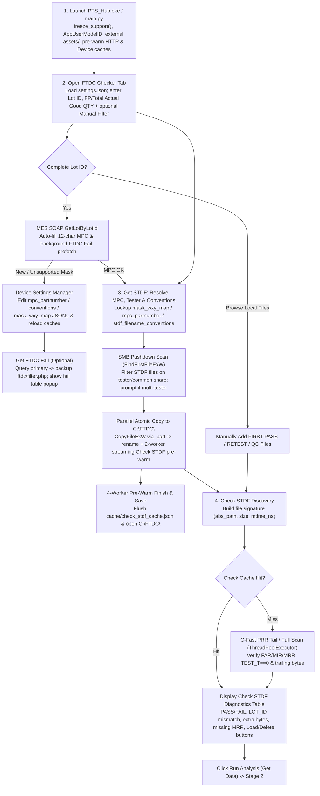
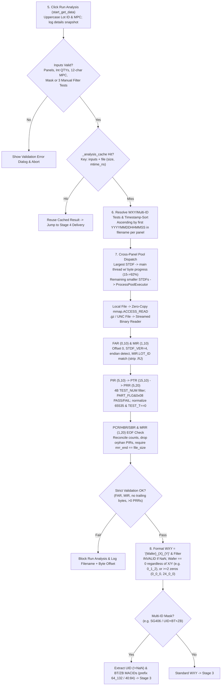
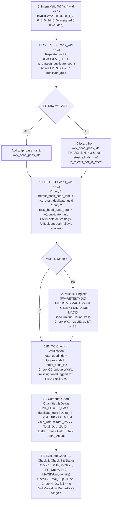
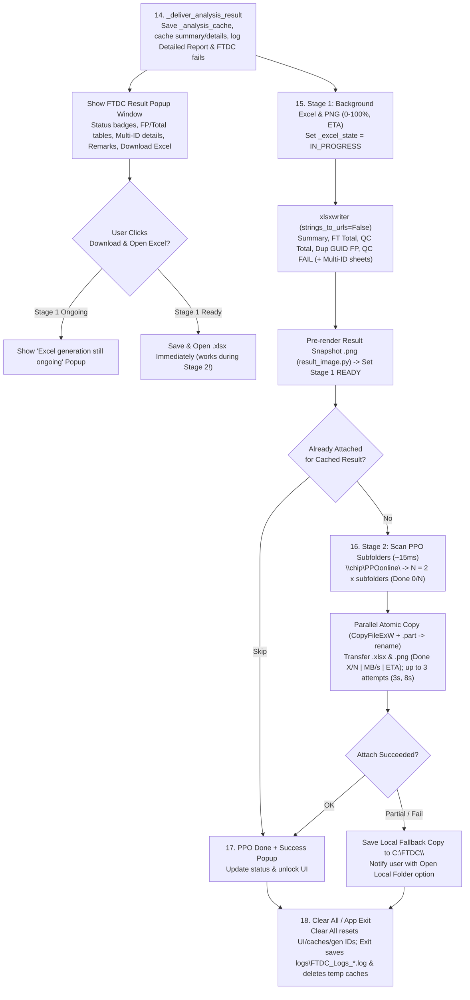

# PTS Hub — Automatic FTDC Checker: Detailed End-to-End Process Flow

Editable source formats in this folder:
- **[PTS_Hub_Process_Flow.pptx](PTS_Hub_Process_Flow.pptx)** *(4-slide Microsoft PowerPoint deck — native editable shapes, diamonds & snapped connectors)*
- **[PTS_Hub_Process_Flow.drawio](PTS_Hub_Process_Flow.drawio)** *(4-tab Draw.io / diagrams.net XML diagram)*
- Below: 4 detailed text-editable **Mermaid** diagrams covering the complete architecture.

---

## Stage 1: Startup, MES Lookup, Get STDF & Check STDF

---

## Stage 2: Run Gate, Strict Validation, Parallel STDF Parsing & Coordinate Filtering

---

## Stage 3: Duplicate Engines, Multi-ID Cross-Check, QC Check 4 & FTDC Criteria

---

## Stage 4: Result Popup, Stage 1 Excel/PNG, Stage 2 PPO Auto-Attach & Cleanup

